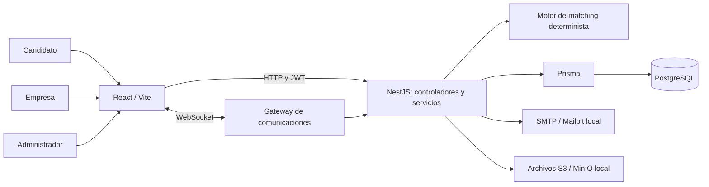
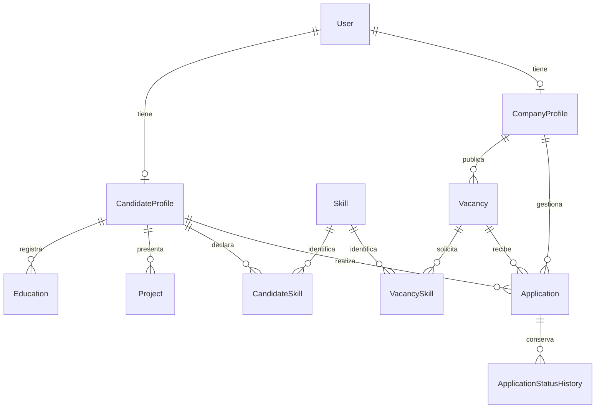
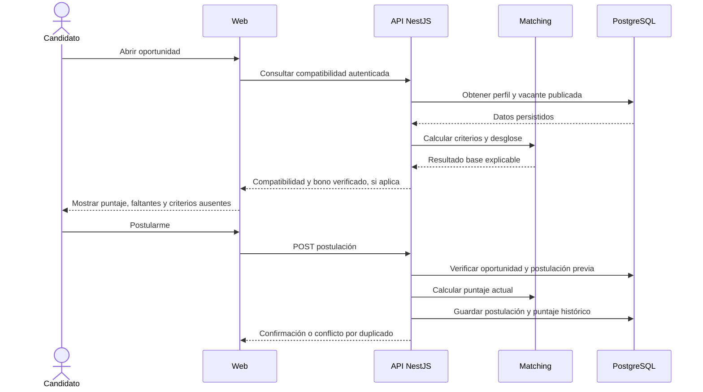
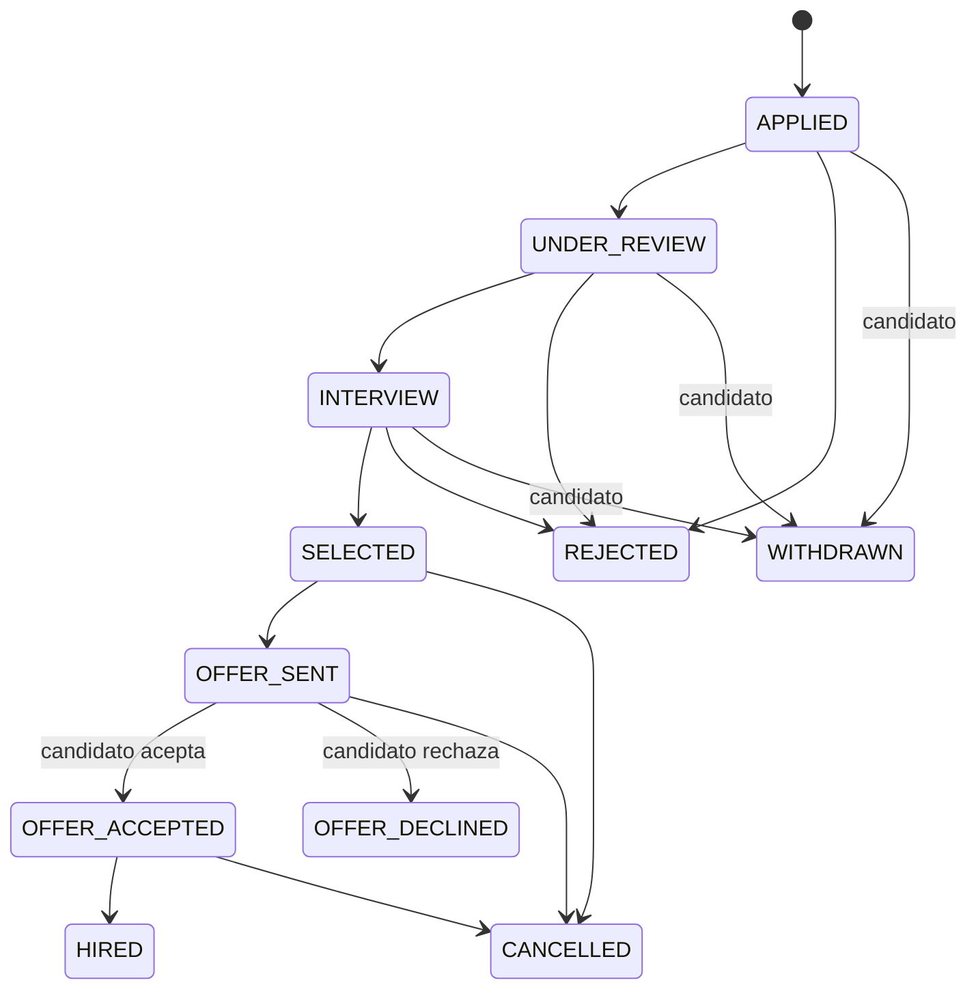

# Diseño del prototipo

Los diagramas Mermaid describen el núcleo del código existente. El modelo de datos está simplificado; `apps/api/prisma/schema.prisma` contiene todos los campos y relaciones.

## Arquitectura

El control de acceso y las reglas de negocio se aplican en la API. React presenta resultados; Prisma administra consultas y relaciones. El matching calcula sobre datos recibidos de los servicios, sin proveedor de IA.

## Modelo entidad-relación central

Restricciones centrales: correo único de usuario, perfil único por usuario y postulación única por candidato/vacante. Los roles condicionan el uso de perfiles; el diagrama no representa esa exclusión como una restricción adicional de base de datos.

## Secuencia de postulación

## Estados del proceso principal

Estados terminales: HIRED, OFFER_DECLINED, CANCELLED, REJECTED y WITHDRAWN. Referencia: `apps/api/src/applications/application-state.ts`.
